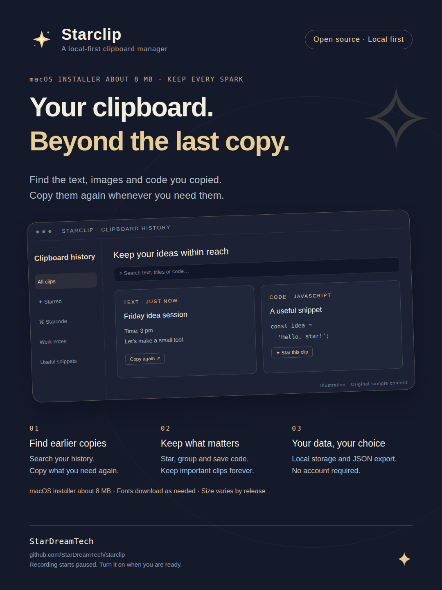

# ✦ Starclip

[简体中文](README.md) | [English](README.en.md)

**A local-first clipboard manager that remembers more than your last copy.** Built with Rust, Starclip helps you find, organize and reuse text, links, code and images.

Save important clips to favorites or groups, then turn text and code into images with Stardraw. No account is required; clipboard history stays on your computer.

[Project](https://github.com/cpython666/starclip) · [Downloads: v0.2.5](https://github.com/cpython666/starclip/releases/tag/v0.2.5) · [Report an issue](https://github.com/cpython666/starclip/issues/new)

The GitHub icon in the top-right corner opens the source repository. **Preferences → Help** also provides project and issue-reporting links. Issue reports are public; remove private clipboard content from screenshots before posting.



All promotional images use original fixed examples, without personal clipboard history.

## Languages

The app supports **Follow system / 简体中文 / English**. Open **Preferences → Habits → Interface language**, select a language and click **Save all preferences**. The interface changes after saving and remembers your choice. Desktop menus and window titles follow the interface; your clips, group names and tags keep their original text.

System mode uses Simplified Chinese for a Chinese system language and English otherwise. The browser preview uses in-memory examples and does not persist clipboard history.

In **Preferences → Share**, promotional text and images follow the interface by default. You can select Chinese or English independently. Each language has **two copy variants**—Short intro and Full intro—and **five promotional images**. Preview, copy, save and favorite actions use the selected material language.

| Topic | English | 简体中文 |
| --- | --- | --- |
| Product overview | [English PNG](public/share/overview-en.png) | [中文 PNG](public/share/overview.png) |
| Your data | [English PNG](public/share/workflow-en.png) | [中文 PNG](public/share/workflow.png) |
| StarPet companion | [English PNG](public/share/companion-en.png) | [中文 PNG](public/share/companion.png) |
| Create images | [English PNG](public/share/creation-en.png) | [中文 PNG](public/share/creation.png) |
| AI access and grants | [English PNG](public/share/ai-en.png) | [中文 PNG](public/share/ai.png) |

Each PNG is 1080 × 1440. Use the Share page to select and copy the corresponding promotional text. The [material catalog](src/product-share-catalog.json) is shared by the app and its native commands. New features should update both READMEs and both language variants together.

## Install and update

Starclip v0.2.5 is available for **Apple Silicon macOS 11+** and **Windows x64**. Download an installer from the [v0.2.5 release](https://github.com/cpython666/starclip/releases/tag/v0.2.5).

On an Apple Silicon Mac, you can also use the project-maintained Homebrew tap:

```sh
brew install --cask cpython666/tap/starclip
```

Quit Starclip before upgrading with Homebrew:

```sh
brew update
brew upgrade --cask cpython666/tap/starclip
```

If Homebrew asks you to trust the cask, run `brew trust --cask cpython666/tap/starclip` and try again. The tap is maintained by this project and is separate from Homebrew's main repository.

Versions with the built-in updater can check for updates in **Preferences → Help**. Update checks notify you; downloading and installing require your action. Updates are checked at startup and at most once every 24 hours automatically. You can disable automatic checks or ignore a particular version. Only stable releases are accepted; no preview update channel or LTS maintenance term is offered.

Update packages have Tauri signature and version verification. macOS builds use ad-hoc signing; Apple Developer notarization and a Windows publisher certificate are not provided. Intel Mac, Linux and other CPU architectures do not have published installers.

For a manual macOS upgrade, quit Starclip, replace `Starclip.app` in Applications and reopen it. On Windows, quit the app and run the new installer. Keep the data directory and app identifier; uninstalling first is unnecessary. Existing history limits and retention settings remain active after upgrading.

The v0.2.5 release passed [signed builds](https://github.com/cpython666/starclip/actions/runs/42848254909) and genuine public v0.2.4 upgrades on [macOS](https://github.com/cpython666/starclip/actions/runs/42856720920) and [Windows](https://github.com/cpython666/starclip/actions/runs/42851606421), including automatic restart, fixed data and preferences, schema 4 → 5 and obsolete automatic snapshot cleanup. The old application backup remains. Native checks used temporary trusted HTTPS services on disposable runners. All eight public attachments and the stable manifest were separately downloaded and matched the tested bytes; this is separate from a native public GitHub/CDN delivery test. [Homebrew is synchronized](https://github.com/cpython666/starclip/actions/runs/42861273222); no local production app was installed. See the [release guide](docs/releases.md) and [verification records](docs/verification.md), currently in Chinese, for precise scope.

## Features

| Area | What you can do |
| --- | --- |
| Clipboard history | Capture text, links, code, static images and file path references; search and copy clips again |
| Organization | Favorites, permanent retention, colored groups, titles, tags, source filters and privacy filters |
| Views | Grid, list and Meteor Bar for horizontal browsing and quick copying |
| Starcode | Save and edit code snippets, choose from 13 languages, format JSON, export Markdown or PNG |
| Stardraw | Direct entries for code cards, handwriting notes and Markdown images, with local preview and export |
| Moonlight Note | Render handwritten-style notes using an embedded local engine, 23 on-demand font choices and 11 paper styles |
| StarPet / StarBud | Optional original companion with 32 expressions, interaction, growth, achievements and accessories |
| Appearance | Five themes, system theme selection, accent colors, gradients and a local PNG sticker |
| Local insights | Capture and reuse counts, time distributions and history composition, without uploading clip content |
| Data management | JSON import/export, custom data folders, migration and cleanup with a preview |
| AI access | Explicit, limited, read-only MCP / CLI / Skill access; no built-in AI model |

A new desktop installation starts **empty, with recording paused**. When you enable or resume recording, the app first checks the current clipboard, then watches subsequent changes. Pausing before copying sensitive information remains useful.

History is queried in SQLite in pages of 50. Search and filters cover the full history, while the list keeps the current page. Images load thumbnails when visible and originals in the detail view. Counts and filter choices come from the full database, with caching when data is unchanged.

Repeated text reuses its existing record and refreshes its recent timestamp, preserving favorites, groups and protection. Ordinary history is unlimited by default: both the history-count and retention-day limits must be set to unlimited to disable those automatic limits. Automatic cleanup protects favorites, permanently retained clips and grouped records. Pausing capture does not pause retention maintenance.

File records store paths, entry types and order. They do not copy the referenced files' contents into the library, or grant access to those files through the AI interface. Static image limits are 16 million pixels, 16,000 pixels per edge and 20 MiB of PNG data; decoding can temporarily use additional memory.

Fonts download only when selected, with fixed-size and SHA-256 verification, and can then render locally. They are not bundled as full font files in the initial installer. The macOS installer is about 8 MB; actual size varies by release and is separate from runtime memory or downloaded fonts. Animated StarPet has not reached the desired tens-of-MiB memory target.

## New in v0.2.5

This release includes:

- Markdown images with three adapted MIT-licensed Drake themes, width and font-size controls and 2× PNG export. The main screen provides direct entries alongside code cards and handwriting notes. Embedded images, math and automatic pagination are not supported; see [scope and platform verification limits](docs/markdown-images.md).
- Strict image deduplication using a hash to find candidates, followed by exact PNG or decoded RGBA comparison.
- One clip containing a caption and an ordered gallery of 1–50 images, up to 100 MiB of PNG data in total. Repeated images and image order are preserved. Arbitrary text/image interleaving is not stored.
- Gallery thumbnails, full-window image viewing, zooming, panning and previous/next navigation.
- Multi-image selection, copying image files, directory export and a native drag-out entry point. Receiving apps determine how multiple images are accepted; Windows and final drag/drop scenarios still require specific GUI verification.
- Favorites for the selected promotional text or all five images in a material language.
- Numeric pagination, ellipsis jumps and direct page input; favorites sorted by last update, creation time, copy count or custom order, with independent top pins and drag reordering.
- Restoring your last category, page and settings tab; left-clicking the tray/menu bar icon opens the window, while right-clicking opens the menu. Platform GUI validation remains scenario-specific.
- Internal pre-upgrade backups with cleanup of obsolete automatic snapshots after the new app opens and validates its database. Recovery-point lists, manual creation and restore controls are no longer exposed.

v0.2.5 uses **SQLite schema 5 and history JSON 5**, with import support for JSON 1–5. Earlier v0.2.4 uses schema/JSON 4. Migrations save a consistent snapshot first, support recognized older layouts directly, and reject unknown, damaged or future layouts. Never open a newer database with an older app; a program rollback requires compatible data.

These changes are included in the v0.2.5 download. See [image collections](docs/image-collections.md), [backup cleanup](docs/recovery-retention.md) and [verification](docs/verification.md), currently in Chinese.

## Keyboard shortcuts

| Action | Shortcut |
| --- | --- |
| Show or hide Starclip globally | `⌘/Ctrl + Shift + V` by default |
| Focus search | `⌘/Ctrl + K` |
| Select a clip | Arrow keys |
| Copy the selected clip | `Enter` |
| Quick-copy clips 1–9 | `⌘/Ctrl + 1–9` |
| Cycle categories or groups | `⌘/Ctrl + Shift + ←/→` |
| Save preferences | `⌘/Ctrl + S` |

Change the global shortcut in **Preferences → Habits → Global shortcut**, then save. A value such as `CommandOrControl+Shift+V` works across the supported desktop platforms. Starclip tries to register the new shortcut before replacing the old one. If registration fails, it reports that another app may be using it and keeps the existing shortcut. This uses the operating system's registration result; it does not identify the app that owns a shortcut or enumerate every shortcut in other apps. v0.2.5 adds a status icon beside the field: a green check for the confirmed binding, gray for an unchecked draft, a saving indicator, and a red warning after registration fails. Hover for details. New combinations are checked when saved; the browser demo cannot test system shortcut registration.

Other shortcuts operate inside Starclip. Typing, tutorials and dialogs do not trigger history copying or category changes. Quick-copy can hide the window and return focus to your previous app; Starclip writes to the clipboard without injecting an automatic paste.

Closing the main window keeps the background process running. It releases the WebView when safe, but retains unsaved drafts and active work. Reopen through the global shortcut, app icon or tray/menu. Use **Quit Starclip** to exit completely. Launch at login, start hidden and tray visibility are independent preferences.

## Privacy and data

History, databases and backups are **local and unencrypted**. No account or cloud synchronization is required. Optional usage statistics do not contain clipboard content, titles, domains or record IDs. The available modes are off, a random identifier for each run, and a random installation identifier; statistics are not collected when the build has no receiver configured.

Local privacy rules can protect sensitive clips. The app recognizes some system clipboard sensitivity markers and available source-app information, but cannot guarantee detection of all secrets or applications. Collapsing a private clip is not encryption. Images have no OCR and are excluded from the official AI interface.

AI access starts disabled on each launch. Grants specify record IDs, fields, limits and expiry; new records do not join an existing grant. Private, unscanned, image, gallery and file records are excluded. Revoke a connection at any time; restarting requires a new grant. Content already returned to an external client cannot be recalled. StarPet control has a separate grant and can be enabled without exposing history.

History JSON contains clips, groups, original images and supported metadata; current development JSON 5 also preserves captions, gallery order and optional favorites order. It excludes app preferences, StarPet growth, downloaded fonts and managed components. StarPet growth has a separate export. JSON imports are validated as a whole and merged transactionally without lowering existing protection or changing your settings. Limits include 20 MiB, 10,000 clips, 1,000 groups and 256 million image pixels per backup. The browser demo rejects image backups rather than silently dropping images.

The default macOS database is `~/Library/Application Support/com.starclip.desktop/starclip.sqlite3`. Windows uses Tauri's per-user app data directory. A custom folder shown in Preferences takes precedence. Do not delete the data directory when replacing the app.

Updates, font downloads and optional usage statistics can use the network; the whole product is not described as fully offline. Further details are in the [privacy guide](docs/privacy-ai.md), [AI guide](docs/ai-access.md) and [telemetry guide](docs/telemetry.md), currently in Chinese.

## Build and preview

Stack: **Rust / Tauri 2 / SQLite / Vue 3 / TypeScript / Vite**. Use Node.js 22.12+, the pinned Rust toolchain and Tauri's platform prerequisites.

```sh
npm ci
npm run tauri icon public/starclip.svg
npm run app
```

`npm run app` installs JavaScript dependencies and starts an isolated live desktop preview. Use `npm run dev` for the browser demo or `npm run tauri build` for a desktop bundle.

Live native preview: run `npm run app`, or double-click `启动实时预览.command` on macOS. Uses `com.starclip.livepreview` with separate data, initially paused capture, no telemetry endpoint or updater source. UI changes hot-reload; Rust changes rebuild. Node.js, Rust and platform build tools are required. No packaging or publishing needed; Ctrl+C stops the session. Raw `npm run tauri dev` uses the normal app identity; use the isolated entry for testing.

For routine changes, run the relevant checks. Before integration or release:

```sh
npm test
npm run build
cargo test --manifest-path src-tauri/Cargo.toml --no-default-features
```

For an isolated macOS preview:

```sh
npm run build:preview:mac
```

This creates **Starclip Preview**, with a separate app identifier and data directory, paused recording on a fresh profile, no telemetry endpoint and no update source. It outputs an app and DMG in `artifacts/preview-local.noindex/<build-time>/` and prints a ready-to-copy `open "…/Starclip Preview.app"` command. Use original fixed fixtures for testing, rather than personal history.

[GitHub Actions](https://github.com/cpython666/starclip/actions) runs checks and produces platform artifacts. Compilation and automated checks do not substitute for native clipboard, tray, shortcut or installation testing. OCR, animated GIFs, cloud sync, public clip links, automatic paste, code execution and built-in AI analysis are not implemented.

## Contributing and support

Keep both READMEs and both language catalogs/materials aligned when changing a feature. User content is not translated. Do not commit real clipboard data, databases, backups, logs or credentials.

Report your app version, operating system, reproduction steps and expected result in an [issue](https://github.com/cpython666/starclip/issues/new). Redact private clipboard content before posting screenshots. Detailed product and acceptance records remain in [docs/product.md](docs/product.md) and [docs/verification.md](docs/verification.md), currently in Chinese.

MIT License.
